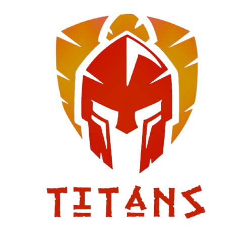

# Administração

<div align="center">
  
</div>

---

## Sobre

Repositório destinado à documentação da administração da Equipe Titans: membros, inventário, viagens e demais processos internos da equipe.

## Como contribuir

O padrão de branches, commits, issues e pull requests está no [Guia de Contribuição](CONTRIBUTING.md).

## Rodando localmente

```bash
python3 -m venv .venv
source .venv/bin/activate
pip install -r requirements.txt
mkdocs serve
```

## Quadro Kanban na Home

A Home mostra o [Kanban administração](https://github.com/orgs/team-titans-unb/projects/17). O hook [`hooks/kanban.py`](hooks/kanban.py) busca o quadro na API do GitHub durante o build e coloca no lugar do marcador `<!-- kanban -->`.

- **Localmente:** usa o `gh` logado (`gh auth login`) ou a variável `KANBAN_TOKEN`. Sem token, aparece só um link para o quadro.
- **No GitHub Actions:** precisa do secret `KANBAN_TOKEN` no repositório (*Settings → Secrets and variables → Actions*), com um token *classic* com o escopo `read:project` (ou um *fine-grained* da organização com **Projects: Read**). O `GITHUB_TOKEN` padrão do Actions não tem acesso a Projects da organização.
- O site é regerado a cada 3 horas (e pode ser disparado à mão em *Actions → Run workflow*), então o quadro tem até 3 horas de atraso.

## Licença

Este projeto é distribuído sob a licença [GNU GPL v3](LICENSE).

---

## Histórico de Versões

| Versão | Descrição | Autor(es) | Data de Produção | Revisor(es) |
| :----: | --------- | --------- | :--------------: | :--------------: |
| `1.0` | Modelagem inicial do readme | [Luiz](https://github.com/luizfaria1989) | 11/11/2026 | — |
