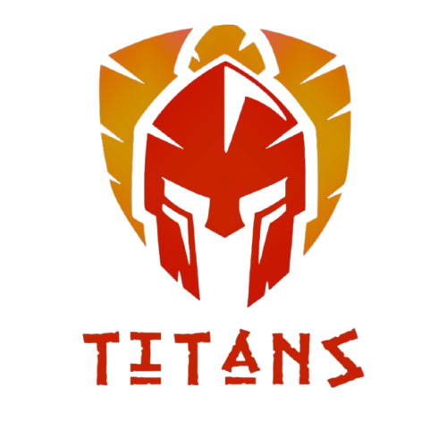

# Administração

  

---

## Sobre

Repositório destinado à documentação da administração da Equipe Titans: membros, inventário, viagens e demais processos internos da equipe, em um só lugar.

## Áreas

| Área | Conteúdo | Situação |
| :--- | :--- | :--- |
| [Membros](pages/membros/index.md) | Membros ativos da equipe e organização no drive | Em construção |
| [Inventário](pages/inventario/index.md) | Componentes da Titans, quantidades e onde ficam guardados | Em construção |
| [Viagens](pages/viagens/index.md) | Listas de itens e preparação para competições | Em construção |

## Quadro de tarefas

Andamento das tarefas no [Kanban administração](https://github.com/orgs/team-titans-unb/projects/17). O quadro é atualizado automaticamente a cada 3 horas.

<!-- kanban -->

## Integrantes

<!-- Uma linha por integrante. Foto: salve em docs/assets/integrantes/ e troque o campo por  -->

| Nome | Função | Foto |
| --- | --- | --- |
| <mark>[nome]</mark> | <mark>[função]</mark> | <mark>[foto]</mark> |
| <mark>[nome]</mark> | <mark>[função]</mark> | <mark>[foto]</mark> |
| <mark>[nome]</mark> | <mark>[função]</mark> | <mark>[foto]</mark> |

---

## Histórico de Versões

| Versão | Descrição | Autor(es) | Data de Produção | Revisor(es) |
| :----: | --------- | --------- | :--------------: | :--------------: |
| `1.0` | Criação da página inicial no padrão da equipe: áreas, quadro Kanban e integrantes | [Luiz](https://github.com/luizfaria1989) | 22/11/2026 | — |
